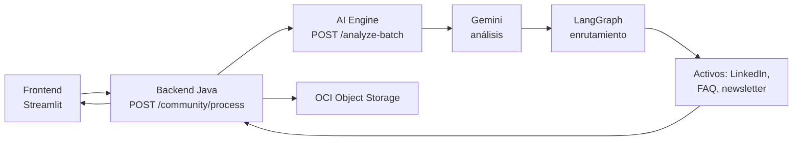

<p align="center">
  
</p>

<!-- NOTA PARA DOCUMENTACIÓN: la interfaz ahora muestra "Aigoraweave", verificar si hay residuos del nombre anterior-->

## Motor inteligente de transformación y distribución de contenido para comunidades digitales

   
<br>
    

> Aigoraweave recibe interacciones de una comunidad digital, las analiza con IA y genera borradores para LinkedIn, FAQ y newsletter, y los presenta en un panel donde el operador puede revisarlos, editarlos, aprobarlos y descargarlos. La publicación queda fuera de la aplicación. Proyecto del equipo 16 de la Hackathon ONE G10 (Oracle Next Education & Alura).

* Última actualización: 25 de octubre de 2026.

## 📑 Tabla de contenidos

<!-- no toc -->
* [Un problema real y con un caso de uso claro](#-un-problema-real-y-con-un-caso-de-uso-claro)
* [Lo que hace Aigoraweave](#-lo-que-hace-aigoraweave)
* [Arquitectura](#-arquitectura)
  * [Pipeline](#pipeline)
  * [Contrato de la API](#contrato-de-la-api)
* [Instalación](#-instalación)
* [Uso](#-uso)
* [Estructura del proyecto](#-estructura-del-proyecto)
* [Cumplimiento del reto](#-cumplimiento-del-reto)
* [Decisiones y límites conocidos](#-decisiones-y-límites-conocidos)
* [Roadmap](#-roadmap)
* [Equipo](#-equipo)
* [Licencia](#-licencia)
* [Contribución](#-contribución)

## 🎯 Un problema real y con un caso de uso claro

Las comunidades digitales activas (Discord, Slack, foros) generan a diario testimonios de logros, dudas técnicas recurrentes y proyectos destacados. La mayor parte de ese contenido se pierde en el historial del chat, y los equipos de marketing y gestión de comunidades no tienen tiempo de leer miles de mensajes para encontrar esas historias y convertirlas en contenido publicable.

## 🧩 Lo que hace Aigoraweave

Le entregas un lote de interacciones (CSV o JSON, hasta 10 por lote; Streamlit limpia los datos y toma las primeras 10 válidas) y Aigoraweave:

* **Analiza cada mensaje** → sentimiento, tema, tipo, relevancia e insight, con Gemini.
* **Enruta según el resultado** → logro o testimonio a LinkedIn, pregunta técnica a FAQ, feedback relevante a newsletter, con LangGraph.
* **Genera el activo de contenido** → con prompts por canal (con ejemplos few-shot de la guía de tono de Marketing para LinkedIn y newsletter, y minimización de datos del autor). Por lote se genera un asset por tipo (el de mayor relevancia; ante empate, el primero en llegar). El FAQ devuelve tema, origen, estado, pregunta y respuesta.
* **Presenta los resultados** → Streamlit muestra un panel con el resumen del análisis (sentimiento, procesadas, descartadas y estado de OCI), gráficos, las interacciones fallidas y las tarjetas de LinkedIn, newsletter y FAQ. Cada tarjeta se puede editar, aprobar o rechazar, y el texto aprobado se descarga como `.txt`. Esa revisión vive solo en la sesión del navegador: no se envía al backend ni se guarda, y la publicación se realiza fuera de la aplicación.

## 🏗️ Arquitectura

Aigoraweave está dividido en tres servicios:

| Capa | Tecnología | Qué hace |
| --- | --- | --- |
| Interfaz | Streamlit | Carga y limpieza del lote (CSV, JSON o JSON pegado), panel de resultados y revisión de los activos (editar, aprobar y descargar) |
| Backend | Java · Spring Boot · Spring Data JPA | Valida, persiste, filtra, orquesta y devuelve los activos |
| Motor de IA | Python 3.12+ · FastAPI · Uvicorn | Expone `/api/v1/analyze-batch` |
| Análisis | Google Gemini Flash-Lite (GenAI SDK) · Pydantic | Análisis estructurado y validado de cada interacción |
| Enrutamiento | LangGraph | Decide qué activo generar según el análisis |
| Base de datos | Oracle Autonomous Database (mTLS con wallet) | Persistencia de interacciones y lotes |
| Almacenamiento | OCI Object Storage | Guarda los activos generados (en local simula la subida con `mock://` por defecto; la subida real con `OCI_OS_MODE=real` está implementada y verificada) |

Streamlit, Java y FastAPI corren en la misma instancia de OCI Compute (AMD E5) y se comunican por localhost. Solo el navegador del operador queda fuera: habla con Streamlit, y el backend y el motor de IA no se exponen.


### Pipeline



### Contrato de la API

| Endpoint | Propósito | Estado |
| --- | --- | --- |
| `POST /api/v1/community/process` | Procesa un lote y devuelve resumen y activos generados | ✅ Disponible |
| `GET /api/v1/assets/pending` | Lista activos pendientes de curaduría | ⏹️ Fuera del MVP |
| `PATCH /api/v1/assets/{id}/curate` | Aprueba, edita o rechaza un activo | ⏹️ Fuera del MVP |

La respuesta incluye `lote_id`, `status`, `resumen_comunidad` (con `total_descartadas`), `activos_distribucion_generados`, `interacciones_fallidas` y `almacenamiento_oci`. Los endpoints de curaduría no existen: la aprobación y la edición viven solo en la sesión de Streamlit y no se envían al backend. Guardarlas en el servidor queda fuera del MVP.

Errores: `400` (cuerpo inválido; un campo vacío o más de 10 interacciones rechazan el lote completo, por eso Streamlit limpia y recorta antes de enviar), `502` (fallo definitivo del AI Engine: respuesta rechazada con 4xx, incluido el límite de cuota 429, error 500 del motor o respuesta inválida; no se reintenta), `503` (AI Engine caído o saturado; el backend lo intenta 3 veces, con esperas de 2 y 4 segundos, antes de responder) y `500` (error interno; responde con el campo `message` y no `mensaje`). Los `502` y `503` no traen `lote_id`. Si alguna interacción falla, o falla la subida a OCI (`error_subida`), la respuesta llega con `status: "parcial"` y los activos generados igual se devuelven. Si ocurre una falla inesperada durante la llamada a la IA, responde `200` con `status: "error"`. El AI Engine recibe hasta 10 interacciones por lote y usa el `id` de cada una dentro del lote; por ahora el análisis por interacción no se persiste en la base de datos; sí queda dentro del JSON que se guarda en OCI.

## 🛠️ Instalación

1. Clona el repositorio:

```bash
git clone https://github.com/No-Country-simulation/G10-LATAM-EQUIPO-16.git
cd G10-LATAM-EQUIPO-16
```

### AI Engine (Python)

1. Crea y activa un entorno virtual:

```bash
cd ai-engine
python -m venv .venv
source .venv/bin/activate        # Windows PowerShell: .\.venv\Scripts\Activate.ps1 (si la política de ejecución lo bloquea: Set-ExecutionPolicy -Scope Process RemoteSigned) | Git Bash: source .venv/Scripts/activate
```

1. Instala las dependencias:

```bash
pip install -r requirements.txt
```

1. Configura tu variable de entorno copiando `.env.example` a `.env`:

   | Variable | Descripción |
   | --- | --- |
   | `GEMINI_API_KEY` | API key de Gemini (obligatoria: el AI Engine no arranca sin ella) |

### Backend (Java)

Requiere JDK 21. Copia `.env.example` de la raíz a `.env` y completa:

| Variable | Descripción |
| --- | --- |
| `ORACLE_DB_USER` | Usuario de Oracle Autonomous Database |
| `ORACLE_DB_PASSWORD` | Contraseña del usuario |
| `ORACLE_WALLET_PATH` | Ruta absoluta a la wallet mTLS |
| `ORACLE_DB_URL` | Cadena de conexión JDBC |
| `AI_SERVICE_URL` | URL del AI Engine (por defecto `http://localhost:8000`) |

<!-- NOTA PARA DOCUMENTACIÓN: AI_SERVICE_URL aún no figura en `.env.example`. Confirmar con Oscar el puerto de uvicorn en la instancia (8000 u 8001) y cómo recibe Java la variable. Quitar esta nota y el paréntesis de la fila al resolverlo. -->

El backend tiene dos perfiles de Spring:

* **Perfil local (por defecto):** usa PostgreSQL en `localhost:5432` y la simulación de OCI (`mock://`). No necesita las variables `ORACLE_*`.
* **Perfil `oracle`:** se activa con `SPRING_PROFILES_ACTIVE=oracle` y usa Oracle Autonomous Database con las variables `ORACLE_*` de arriba. Hibernate solo valida las tablas, así que antes del primer arranque hay que crear el esquema ejecutando a mano `backend/src/main/resources/db/oracle/V1__initial_schema.sql`. Para subir los activos al bucket de verdad se agrega `OCI_OS_MODE=real`. Detalle en `docs/OCI_DEPLOYMENT.md`.

### Frontend (Streamlit)

Desde `frontend/`: crea el entorno virtual como arriba y ejecuta `pip install -r requirements.txt`. Variables opcionales:

| Variable | Descripción |
| --- | --- |
| `BACKEND_URL` | URL completa del endpoint, con la ruta `/api/v1/community/process`. Por defecto `http://localhost:8080/api/v1/community/process`, que ya sirve cuando Streamlit y Java comparten instancia. Si existe `.streamlit/secrets.toml` con `BACKEND_URL`, ese valor tiene prioridad sobre la variable de entorno |
| `BACKEND_TIMEOUT` | Segundos de espera de la respuesta (por defecto 200; el peor caso del backend ronda los 3 minutos) |
| `BACKEND_HEALTH_URL` | URL de `GET /api/v1/health`, que usa el indicador de estado del backend en la barra lateral. Por defecto se deriva de `BACKEND_URL`. El resultado se guarda 30 s, así que un cambio de estado puede tardar en verse |
| `COMMUNITYLAB_DEMO` | Con `1` activa un modo demo con respuestas simuladas, sin backend. Apagado por defecto y no debe definirse en la instancia |

Streamlit debe ejecutarse desde `frontend/` para que lea `.streamlit/config.toml`, que fija el tema claro. La interfaz no tiene modo oscuro.

## ▶️ Uso

Levanta cada servicio en su propia terminal:

```bash
# AI Engine (desde ai-engine/)
uvicorn api:app --reload --host 127.0.0.1 --port 8000

# Backend (desde backend/)
./mvnw spring-boot:run

# Frontend (desde frontend/)
streamlit run app.py
```

* AI Engine: `http://127.0.0.1:8000/docs` y `GET /health`.
* Backend: `http://localhost:8080/api/v1/health`.
* Frontend: `http://localhost:8501`. Envía el lote a `BACKEND_URL`, que por defecto apunta al backend local. La barra lateral indica si el backend responde.
* **Cargar ejemplo** llena el campo JSON con 9 mensajes de prueba, útil para recorrer el flujo completo.

### Ejemplo: procesar un lote

```json
{
  "origen_comunidad": "Discord_Grupo_ONE_G10",
  "periodo_referencia": "Semana_04",
  "interacciones": [
    {
      "autor": "Lucas Albuquerque",
      "canal": "#dudas-langgraph",
      "tipo": "pregunta_tecnica",
      "texto": "Tengo dudas sobre cómo estructurar los nodos condicionales en LangGraph."
    }
  ]
}
```

La respuesta incluye `lote_id`, `resumen_comunidad` (total procesado, descartadas, sentimiento predominante, temas principales), `activos_distribucion_generados` (post de LinkedIn, destacado de newsletter y sugerencia de FAQ con pregunta y respuesta, cada uno con su `interaccion_id`), `interacciones_fallidas` y `almacenamiento_oci` (bucket, ruta y estado).

### Pruebas

Ninguna llama a Gemini ni a OCI:

```bash
./mvnw clean verify              # desde backend/
pytest                           # desde ai-engine/ (instalar pytest aparte)
pip install -r requirements-dev.txt && pytest   # desde frontend/
```

## 🗂️ Estructura del proyecto

```text
G10-LATAM-EQUIPO-16/
├── ai-engine/          # Servicio Python: análisis y generación de contenido
├── backend/            # API Java Spring Boot: ingesta, persistencia, orquestación, OCI
├── docs/               # Guía de tono y prompts, dataset de prueba
├── data_science        # Dataset de prueba (Stack Exchange), scripts y reportes de calidad
├── frontend/           # Interfaz Streamlit (incluye `.streamlit/config.toml`)
├── .env.example        # Plantilla de variables de entorno
├── LICENSE
└── README.md
```

> No versionados por seguridad (ver `.gitignore`): `.env` y la wallet de Oracle.

<!-- NOTA PARA DOCUMENTACIÓN: Se removio la carpeta `workflows/`. Confirmar el árbol y borrar esta nota. -->

## ✅ Cumplimiento del reto

Estado frente al checklist de requisitos mínimos del reto, al 25 de octubre de 2026.

| Requisito del reto | Estado | Dónde verlo |
| --- | --- | --- |
| Ingestión de interacciones (CSV o JSON) | ✅ Cumplido | `POST /api/v1/community/process` y carga de archivo en Streamlit |
| Análisis de sentimiento y temas con LLM | ✅ Cumplido | Gemini en el AI Engine (`ai-engine/`) |
| Al menos 2 formatos de activos | ✅ Cumplido | El post de LinkedIn y el destaque de newsletter (sección, titular y resumen) se generan completos. El FAQ devuelve tema, origen, pregunta y respuesta |
| Orquestación del flujo | ✅ Cumplido | LangGraph enruta cada interacción al activo que corresponde |
| Integración con OCI Object Storage (obligatorio) | ✅ Cumplido | Subida real con Instance Principals, fusionada en `main` y verificada en una instancia de OCI. Por defecto el backend simula la subida (`mock://`); para guardar en el bucket se ejecuta con `OCI_OS_MODE=real`. La ruta `activos/<periodo>/paquete-distribucion-<lote_id>.json` se verificó el 26/10/2026 en la demo permanente: cuatro lotes con `guardado_con_exito`, un objeto abierto en la consola de OCI y los registros en Oracle (`PROCESSED`). Ver `docs/EVIDENCIA_ALMACENAMIENTO_OCI.md` y `docs/OCI_DEPLOYMENT.md` |
| Demostración de 3 o más ejemplos de transformación | ✅ Cumplido | Cuatro ejecuciones en la demo permanente (26/10/2026), sin fallas: ejemplo del panel (9), Excel (10), Reclutamiento (10) y RutaExpress (10; 9 procesadas y 1 descartada), con sentimientos neutral, positivo y mixto. Los escenarios están en `examples/demo/` y la evidencia, en `docs/EVIDENCIA_ALMACENAMIENTO_OCI.md` |
| Repositorio con documentación y diagrama del pipeline | 🟡 En progreso | Diagrama incluido, logo del proyecto en `docs/assets/logo/` y guía de despliegue en OCI integrada (`docs/OCI_DEPLOYMENT.md`) |

<!-- NOTA PARA DOCUMENTACIÓN (tabla de arriba):
  - Antes de grabar el demo: validar el recorrido completo en vivo sobre OCI y confirmar que el backend desplegado use el bucket real (estado `guardado_con_exito`, no `simulado`). -->

Recursos opcionales:

| Recurso opcional | Estado |
| --- | --- |
| AI Engine desplegado en OCI Compute | 🟡 Desplegado y verificado con Gemini real en la instancia (con minimización de datos del autor y manejo de errores). Java y FastAPI conviven en la misma instancia y se comunican por localhost. La versión desplegada es anterior a la resiliencia de Gemini y al ajuste de prompts de `main`. Ver `docs/OCI_DEPLOYMENT.md` |
| Backend con reintentos y lote de distribución | ✅ Desplegado en OCI (19/10/2026). Validado el flujo principal end-to-end desde Streamlit con 1 interacción (HTTP 200): Backend Java → FastAPI → Oracle Database → OCI Object Storage. Lote Oracle: `9E408368FD5B4D2B9BC9A26F549E06AF`; objeto: `resultados/batch_7c75b113-e012-4ee6-93f1-5fb6234d38d2.json`. Persistencia Oracle `PROCESSED` y JSON en OCI verificados. No se probaron en esta validación el HTTP 429 del AI Engine ni lotes con múltiples interacciones. La protección ante fallos posteriores a la IA ya está en `main`; la versión desplegada es anterior |
| Panel de resultados en Streamlit | ✅ Implementado: KPIs, gráficos, tarjetas de los tres activos, interacciones fallidas y estado de OCI |
| Panel de curaduría en Streamlit (editar, aprobar y publicar) | 🟡 Parcial: cada activo se puede editar, aprobar, rechazar y descargar, pero solo dentro de la sesión (no se guarda en el backend) y no hay publicación |

<!-- NOTA PARA DOCUMENTACIÓN (tabla de arriba): tras redesplegar el AI Engine y el backend con lo último de `main`, repetir la prueba en la instancia y quitar las frases "la versión desplegada es anterior". -->

## 🧭 Decisiones y límites conocidos

Lo que decidimos, por qué, y lo que sabemos que todavía no está.

### Decisiones de diseño

* **Revisión humana antes de publicar.** El sistema genera borradores y el operador los revisa en Streamlit: puede editar el texto, aprobar o rechazar, y descargar lo aprobado como `.txt`. Esa revisión vive solo en la sesión: no se envía al backend, no se guarda en OCI (el paquete conserva el texto original del motor) y se pierde al reiniciar la sesión. La publicación se realiza fuera de la aplicación; no se publica nada automáticamente.
* **Un activo por tipo y por lote.** De cada tipo (LinkedIn, FAQ, newsletter) se genera el de mayor relevancia; ante empate, el primero en llegar. Mantiene el costo y la revisión acotados.
* **Hasta 10 interacciones por lote.** El backend rechaza con `400` un lote de más de 10, en vez de procesarlo a medias. Streamlit nunca le envía más: toma las primeras 10 interacciones válidas y avisa cuántas ignoró.
* **Errores del servicio de IA.** El AI Engine distingue la saturación de Gemini (`503`) del límite de cuota (`429`) y de los fallos permanentes (`500`). El backend reintenta solo los temporales (hasta 3 intentos, con esperas de 2 y 4 segundos) y responde `503` si siguen fallando (el AI Engine no reintenta por su cuenta, para no multiplicar los intentos); el `429`, el `500` del motor y las respuestas inválidas se devuelven como `502` sin reintentar.
* **Minimización de datos del autor.** Antes de enviar texto a Gemini, el módulo `privacy.py` quita el campo `autor` de los prompts y reemplaza el nombre completo del autor, si aparece en el mensaje, por un marcador. El contenido generado no nombra a la persona: usa "una persona de la comunidad". Esto difiere a propósito del ejemplo del reto, donde el post nombra a la autora. Preferimos no publicar ni enviar a un servicio externo datos personales sin consentimiento, porque un error ahí es difícil de revertir y omitir el nombre solo resta calidez al texto. La decisión quedó cerrada con Marketing: se adopta la opción anónimo/minimizado, sin nombres reales ni iniciales. Mencionar al autor en el futuro, por ejemplo con consentimiento explícito, sería una decisión nueva.
* **Datos personales.** La base de datos guarda el `author` y el `text` de cada interacción tal como llegan. La minimización aplica a lo que se envía a Gemini, no a lo que se guarda en Oracle.
* **Datos de demostración y de entrenamiento por separado.** Los mensajes de demostración (botón `Cargar ejemplo`) provienen de un dataset público de Stack Exchange (atribución y licencia CC BY-SA), con los autores reemplazados por "Una persona de nuestra comunidad" y las menciones de usuarios anonimizadas. El dataset completo vive en `data_science/` y se usa para entrenar y evaluar el modelo.
* **Secretos fuera del repositorio.** `.env` y la wallet de Oracle no se versionan.
* **Nombre del proyecto e identificadores técnicos.** El proyecto se llama Aigoraweave. Los identificadores técnicos conservan el nombre original, CommunityLab (paquete Java `com.nocountry.communitylab`, variable `COMMUNITYLAB_DEMO` y recursos de OCI como el bucket y el grupo dinámico), porque renombrarlos arriesgaba romper lo ya validado y desplegado.

<!-- NOTA PARA DOCUMENTACIÓN: los 9 mensajes de `Cargar ejemplo` (lista `DATOS_EJEMPLO` en `frontend/app.py`) vienen de un dataset público de Stack Exchange con autores neutros, aunque el comentario del código los llama "ficticios". Si el código cambia a mensajes inventados, reemplazar la primera frase de esta viñeta por "La demo usa mensajes ficticios". Borrar esta nota al resolverlo. -->

### Límites conocidos

| Límite | Por qué importa | Estado |
| --- | --- | --- |
| El backend simula la subida a OCI por defecto | Si se despliega sin `OCI_OS_MODE=real`, los resultados no llegan al bucket y la ruta devuelta es `mock://` | Documentado en `docs/OCI_DEPLOYMENT.md` |
| El esquema de Oracle se crea a mano | No hay migraciones automáticas (Flyway): se ejecuta `V1__initial_schema.sql` al crear una base nueva e Hibernate solo valida las tablas | Documentado en `docs/OCI_DEPLOYMENT.md` |
| La minimización solo cubre el nombre completo conocido del autor | No elimina nombres parciales, nombres de terceros, correos ni teléfonos dentro del mensaje. Es una protección inicial, no una anonimización completa | Conocido; ampliar queda para después |
| Los posts no mencionan al autor | Los testimonios resultan menos personales que en el ejemplo del reto | Decidido con Marketing: anónimo/minimizado |
| El titular del newsletter y el título de LinkedIn no están redactados | Copian la conclusión y el tema del análisis, y pueden afirmar más de lo que dice el mensaje original. El operador puede corregirlos en la tarjeta antes de aprobar | Conocido |
| La curaduría no se guarda | Las aprobaciones y ediciones viven solo en la sesión del navegador: no llegan al backend ni al bucket, y no existen endpoints de curaduría. La publicación se hace fuera de la aplicación | Descartado para el MVP |
| Las decisiones de curaduría dependen del `lote_id` | En modo demo, varios escenarios comparten el mismo identificador, así que una aprobación podría reaparecer al cambiar de escenario | Conocido; solo afecta al modo demo |
| Tras un intento fallido se sigue mostrando el último resultado | La pantalla conserva el resultado anterior y no lo identifica como tal | Planificado |
| Si falla una interacción, el lote llega con `status: "parcial"` | El motivo de cada fallida es un texto fijo y, si falla un activo, no se informa cuál | Planificado |
| El análisis por interacción no se persiste en la base de datos | Solo queda dentro del JSON guardado en OCI; no se puede consultar ni reutilizar desde Oracle | Planificado |
| El servicio no expone tiempo ni tokens por lote | En corridas de demostración con mensajes ficticios se midieron de 2 a 4 llamadas a Gemini, de unos 750 a 2.500 tokens y de 3 a 19 s de extremo a extremo según el lote y la corrida; el costo y los límites de uso aún no están calculados | Parcialmente medido |
| Streamlit se sirve en la demo permanente, pero su despliegue no está documentado | La demo (`https://aigoraweave.duckdns.org`) se sirve mediante Nginx y un servicio systemd (`aigoraweave-pr50-frontend.service`, puerto 8502) y se usó en las ejecuciones del 26/10/2026. Falta documentar el procedimiento en el repositorio. Streamlit debe arrancar desde `frontend/` para leer `.streamlit/config.toml`. `st.secrets` pisa a `BACKEND_URL` de la variable de entorno y `requirements.txt` no fija versiones | Parcial |
| Peor caso de unos 3 minutos | Con el AI Engine caído o colgado, 3 intentos de hasta 60 s más 6 s de esperas | Conocido |
| Límite por minuto de Gemini (`429`) | El backend responde `502` sin reintentar: varios lotes seguidos en menos de un minuto pueden fallar con el plan gratuito | No enviar lotes seguidos |
| El backend no es idempotente | Reenviar el mismo lote duplica las interacciones y crea otro lote y otro objeto en el bucket | Conocido |

Cuando uno de estos puntos se resuelva, se mueve a la tabla de cumplimiento y se elimina de aquí.

<!-- NOTA PARA DOCUMENTACIÓN: considerar eliminar "Cuando uno de estos puntos se resuelva, se mueve a la tabla de cumplimiento y se elimina de aquí." en la version final. -->

## 🗺️ Roadmap

### Core

* [x] Estructura del backend y conexión a Oracle Autonomous Database
* [x] Entidades, repositorios y endpoint `POST /community/process`
* [x] AI Engine con Gemini, LangGraph y `/analyze-batch`
* [x] Integración Backend → AI Engine → Backend
* [x] MVP del Frontend en Streamlit y vista de resultados
* [x] Frontend con limpieza del lote, límite de 10 y URL configurable
* [x] Dashboard en Streamlit con KPIs, gráficos y curaduría de sesión (editar, aprobar y descargar)
* [x] AI Engine desplegado en OCI (pendiente: redesplegar con los últimos cambios de `main`)
* [x] Subida real de los activos a OCI Object Storage (verificada en una instancia de OCI)

### Documentación

* [x] Guía de tono de voz y prompts Few-Shot (ejemplos corregidos e integrados)
* [x] Dataset inicial de prueba (9 mensajes)

### En progreso

* [ ] Documentar el despliegue de Streamlit en la instancia (servicio systemd y Nginx)
* [ ] Redesplegar el backend y confirmar la ruta `activos/<periodo>/…` en el bucket
* [ ] Validar el recorrido completo en vivo sobre OCI con el bucket real
* [x] Reintentos ante errores temporales de la IA
* [x] Integrar la guía de tono de voz en los prompts (ejemplos few-shot de LinkedIn y newsletter; la minimización de datos del autor ya está en `main`)
* [x] Dataset de demo balanceado (un mensaje por tipo de activo)
* [x] Filtro previo de Data Science

<!-- NOTA PARA DOCUMENTACIÓN: El filtro de Data Science no esta en el flujo -->

### Fuera del MVP

* Curaduría persistente: endpoints `/assets/pending` y `/assets/{id}/curate`, y guardar en el servidor las aprobaciones y ediciones (hoy solo viven en la sesión de Streamlit)

## 👥 Equipo

| Rol | Responsable |
| --- | --- |
| Project Management | Gabriela Correa |
| Backend (Java) | Bryan Naragio, Roberto Borja, Alexandra Estupiñan |
| Backend (Python) | Andrea Jaramillo |
| Machine Learning / prompt engineering | Oscar Cruz |
| Data Science | Saul Mendoza |
| Marketing / copywriting / tono de voz | Uziel Green |
| Frontend | Camilo Moroch |
| Infraestructura y despliegue | Oscar Cruz |

## 📄 Licencia

Revisa el archivo [LICENSE](LICENSE) para más detalles.

## 🤝 Contribución

Este es un proyecto de equipo. Todo cambio entra por rama y pull request hacia `main`, con revisión de al menos otra persona del equipo. Si encuentras un bug, abre un [issue](https://github.com/No-Country-simulation/G10-LATAM-EQUIPO-16/issues).

<!-- NOTA PARA DOCUMENTACIÓN: considerar eliminar "Si encuentras un bug, abre un issue" -->
