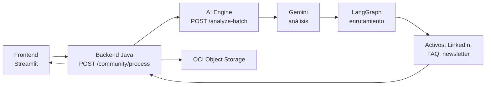

<p align="center">
  
</p>

## Motor inteligente de transformación y distribución de contenido para comunidades digitales

   
<br>
    

> CommunityLab recibe interacciones de una comunidad digital, las analiza con IA y genera contenido listo para revisar (post de LinkedIn, FAQ y destacado de newsletter), con curaduría humana antes de publicar. Proyecto del equipo 16 de la Hackathon ONE G10 (Oracle Next Education & Alura).

* Última actualización: 16 de octubre de 2026.

## 📑 Tabla de contenidos

<!-- no toc -->
* [Un problema real y con un caso de uso claro](#-un-problema-real-y-con-un-caso-de-uso-claro)
* [Lo que hace CommunityLab](#-lo-que-hace-communitylab)
* [Arquitectura](#-arquitectura)
  * [Pipeline](#pipeline)
  * [Contrato de la API](#contrato-de-la-api)
* [Instalación](#-instalación)
* [Uso](#-uso)
* [Estructura del proyecto](#-estructura-del-proyecto)
* [Cumplimiento del reto](#-cumplimiento-del-reto)
* [Decisiones y límites conocidos](#-decisiones-y-límites-conocidos)
* [Roadmap](#-roadmap)
* [Equipo](#-equipo)
* [Licencia](#-licencia)
* [Contribución](#-contribución)

## 🎯 Un problema real y con un caso de uso claro

Las comunidades digitales activas (Discord, Slack, foros) generan a diario testimonios de logros, dudas técnicas recurrentes y proyectos destacados. La mayor parte de ese contenido se pierde en el historial del chat, y los equipos de marketing y gestión de comunidades no tienen tiempo de leer miles de mensajes para encontrar esas historias y convertirlas en contenido publicable.

## 🧩 Lo que hace CommunityLab

Le entregas un lote de interacciones (CSV o JSON, hasta 10 por lote) y CommunityLab:

* **Analiza cada mensaje** → sentimiento, tema, tipo, relevancia e insight, con Gemini.
* **Enruta según el resultado** → logro o testimonio a LinkedIn, pregunta técnica a FAQ, feedback relevante a newsletter, con LangGraph.
* **Genera el activo de contenido** → con prompts por canal (la guía de tono de voz aún no está integrada; la minimización de datos del autor ya está en el código, #16). Por lote se genera un asset por tipo (el de mayor relevancia; ante empate, el primero en llegar). Límite actual: el FAQ devuelve tema, origen y estado, pero la pregunta y la respuesta generadas aún no llegan en la respuesta.
* **Guarda y entrega para curaduría** → una persona aprueba, edita o rechaza antes de publicar. Hoy el sistema genera los borradores y la revisión humana se hace fuera de la aplicación; los endpoints para aprobar, editar o rechazar desde la interfaz siguen planificados.

## 🏗️ Arquitectura

CommunityLab está dividido en tres servicios:

| Capa | Tecnología | Qué hace |
| --- | --- | --- |
| Interfaz | Streamlit | Carga del lote (CSV, JSON o JSON pegado) y visualización de la respuesta |
| Backend | Java · Spring Boot · Spring Data JPA | Valida, persiste, filtra, orquesta y devuelve los activos |
| Motor de IA | Python 3.12+ · FastAPI · Uvicorn | Expone `/api/v1/analyze-batch` |
| Análisis | Google Gemini Flash-Lite (GenAI SDK) · Pydantic | Análisis estructurado y validado de cada interacción |
| Enrutamiento | LangGraph | Decide qué activo generar según el análisis |
| Base de datos | Oracle Autonomous Database (mTLS con wallet) | Persistencia de interacciones y lotes |
| Almacenamiento | OCI Object Storage | Guarda los activos generados (en local simula la subida con `mock://` por defecto; la subida real con `OCI_OS_MODE=real` está implementada y verificada en #22) |

### Pipeline



### Contrato de la API

| Endpoint | Propósito | Estado |
| --- | --- | --- |
| `POST /api/v1/community/process` | Procesa un lote y devuelve resumen y activos generados | ✅ Disponible |
| `GET /api/v1/assets/pending` | Lista activos pendientes de curaduría | ⏳ En progreso |
| `PATCH /api/v1/assets/{id}/curate` | Aprueba, edita o rechaza un activo | ⏳ En progreso |

Errores: `400` (cuerpo inválido; con más de 10 interacciones se rechaza el lote completo), `502` (fallo definitivo del AI Engine: respuesta rechazada con 4xx, incluido el límite de cuota 429, error 500 del motor o respuesta inválida; no se reintenta), `503` (AI Engine caído o saturado; el backend lo intenta 3 veces, con esperas de 2 y 4 segundos, antes de responder) y `500` (error interno; responde con el campo `message` y no `mensaje`). Si alguna interacción falla, la respuesta llega con `status: "parcial"`. El AI Engine recibe hasta 10 interacciones por lote y usa el `id` de cada una dentro del lote; por ahora el análisis por interacción no se persiste.

## 🛠️ Instalación

1. Clona el repositorio:

```bash
git clone https://github.com/No-Country-simulation/G10-LATAM-EQUIPO-16.git
cd G10-LATAM-EQUIPO-16
```

### AI Engine (Python)

1. Crea y activa un entorno virtual:

```bash
cd ai-engine
python -m venv .venv
source .venv/bin/activate        # Windows PowerShell: .\.venv\Scripts\Activate.ps1 (si la política de ejecución lo bloquea: Set-ExecutionPolicy -Scope Process RemoteSigned) | Git Bash: source .venv/Scripts/activate
```

1. Instala las dependencias:

```bash
pip install -r requirements.txt
```

1. Configura tu variable de entorno copiando `.env.example` a `.env`:

   | Variable | Descripción |
   | --- | --- |
   | `GEMINI_API_KEY` | API key de Gemini (obligatoria: el AI Engine no arranca sin ella) |

### Backend (Java)

Requiere JDK 21. Copia `.env.example` de la raíz a `.env` y completa:

| Variable | Descripción |
| --- | --- |
| `ORACLE_DB_USER` | Usuario de Oracle Autonomous Database |
| `ORACLE_DB_PASSWORD` | Contraseña del usuario |
| `ORACLE_WALLET_PATH` | Ruta absoluta a la wallet mTLS |
| `ORACLE_DB_URL` | Cadena de conexión JDBC |
| `AI_SERVICE_URL` | URL del AI Engine (por defecto `http://localhost:8000`; aún no figura en `.env.example`) |

> El archivo `.env` contiene credenciales y no se sube al repositorio.

El backend tiene dos perfiles de Spring:

* **Perfil local (por defecto):** usa PostgreSQL en `localhost:5432` y la simulación de OCI (`mock://`). No necesita las variables `ORACLE_*`.
* **Perfil `oracle`:** se activa con `SPRING_PROFILES_ACTIVE=oracle` y usa Oracle Autonomous Database con las variables `ORACLE_*` de arriba. Hibernate solo valida las tablas, así que antes del primer arranque hay que crear el esquema ejecutando a mano `backend/src/main/resources/db/oracle/V1__initial_schema.sql`. Para subir los activos al bucket de verdad se agrega `OCI_OS_MODE=real`. Detalle en `docs/OCI_DEPLOYMENT.md`.

## ▶️ Uso

Levanta cada servicio en su propia terminal:

```bash
# AI Engine (desde ai-engine/)
uvicorn api:app --reload --host 127.0.0.1 --port 8000

# Backend (desde backend/)
./mvnw spring-boot:run

# Frontend (desde frontend/)
streamlit run app.py
```

* AI Engine: `http://127.0.0.1:8000/docs` (documentación interactiva) y `GET /health`.
* Backend: `http://localhost:8080/api/v1/health`.
* El Frontend apunta fijo a `http://localhost:8080`; la URL configurable está pendiente.

### Ejemplo: procesar un lote

```json
{
  "origen_comunidad": "Discord_Grupo_ONE_G10",
  "periodo_referencia": "Semana_04",
  "interacciones": [
    {
      "autor": "Lucas Albuquerque",
      "canal": "#dudas-langgraph",
      "tipo": "pregunta_tecnica",
      "texto": "Tengo dudas sobre cómo estructurar los nodos condicionales en LangGraph."
    }
  ]
}
```

La respuesta incluye `resumen_comunidad` (total procesado, sentimiento predominante, temas principales) y `activos_distribucion_generados` (post de LinkedIn, destacado de newsletter, sugerencia de FAQ y datos de almacenamiento en OCI).

## 🗂️ Estructura del proyecto

```text
G10-LATAM-EQUIPO-16/
├── ai-engine/          # Servicio Python: análisis y generación de contenido
├── backend/            # API Java Spring Boot: ingesta, persistencia, orquestación, OCI
├── frontend/           # Interfaz Streamlit
├── workflows/          # Automatización de flujos
├── docs/               # Guía de tono y prompts, dataset de prueba
├── .env.example        # Plantilla de variables de entorno
├── LICENSE
└── README.md
```

> No versionados por seguridad (ver `.gitignore`): `.env` y la wallet de Oracle.

## ✅ Cumplimiento del reto

Estado frente al checklist de requisitos mínimos del reto, al 16 de octubre de 2026.

| Requisito del reto | Estado | Dónde verlo |
| --- | --- | --- |
| Ingestión de interacciones (CSV o JSON) | ✅ Cumplido | `POST /api/v1/community/process` y carga de archivo en Streamlit |
| Análisis de sentimiento y temas con LLM | ✅ Cumplido | Gemini en el AI Engine (`ai-engine/`) |
| Al menos 2 formatos de activos | ✅ Cumplido | El post de LinkedIn y el destaque de newsletter (sección, titular y resumen) se generan completos. El FAQ devuelve tema y origen, pero todavía no la pregunta ni la respuesta generadas |
| Orquestación del flujo | ✅ Cumplido | LangGraph enruta cada interacción al activo que corresponde |
| Integración con OCI Object Storage (obligatorio) | ✅ Cumplido | Subida real con Instance Principals, fusionada en `main` (#22) y verificada en una instancia de OCI. Por defecto el backend simula la subida (`mock://`); para guardar en el bucket se ejecuta con `OCI_OS_MODE=real`. Ver `docs/OCI_DEPLOYMENT.md` |
| Demostración de 3 o más ejemplos de transformación | 🟡 En preparación | Hay un lote ficticio y balanceado de 6 mensajes que cubre las rutas de enrutamiento; falta ejecutarlo con Gemini real y publicar los resultados |
| Repositorio con documentación y diagrama del pipeline | 🟡 En progreso | Diagrama incluido, logo del proyecto en `docs/assets/logo/` y guía de despliegue en OCI integrada (#17, `docs/OCI_DEPLOYMENT.md`) |

Recursos opcionales:

| Recurso opcional | Estado |
| --- | --- |
| AI Engine desplegado en OCI Compute | 🟡 Desplegado con la minimización de datos del autor (commit `689b08f`, verificado con Gemini real en la instancia); falta URL configurable y conexión segura; con el manejo de errores del #28 fusionado en `main` y redesplegado (servicio activo, `/openapi.json` responde 200). Guía de despliegue en #17 |
| Backend con reintentos y lote de distribución (#26) | ✅ Desplegado en OCI (19/10/2026). Validado el flujo principal end-to-end desde Streamlit con 1 interacción (HTTP 200): Backend Java → FastAPI → Oracle Database → OCI Object Storage. Lote Oracle: `9E408368FD5B4D2B9BC9A26F549E06AF`; objeto: `resultados/batch_7c75b113-e012-4ee6-93f1-5fb6234d38d2.json`. Persistencia Oracle `PROCESSED` y JSON en OCI verificados. No se probaron en esta validación el HTTP 429 del AI Engine ni lotes con múltiples interacciones. |
| Panel de curaduría en Streamlit | ⏳ Planificado; los endpoints de curaduría aún no existen |

## 🧭 Decisiones y límites conocidos

Lo que decidimos, por qué, y lo que sabemos que todavía no está.

### Decisiones de diseño

* **Curaduría humana antes de publicar.** El sistema genera borradores; una persona aprueba, edita o rechaza (hoy esa revisión se hace fuera de la aplicación). Preferimos eso a publicar automáticamente contenido de una comunidad real.
* **Un activo por tipo y por lote.** De cada tipo (LinkedIn, FAQ, newsletter) se genera el de mayor relevancia; ante empate, el primero en llegar. Mantiene el costo y la revisión acotados.
* **Hasta 10 interacciones por lote.** Si se superan, se rechaza el lote completo (`400`) en vez de procesarlo a medias.
* **Errores del servicio de IA.** El AI Engine distingue la saturación de Gemini (`503`) del límite de cuota (`429`) y de los fallos permanentes (`500`). El backend reintenta solo los temporales (hasta 3 intentos, con esperas de 2 y 4 segundos) y responde `503` si siguen fallando; el `429`, el `500` del motor y las respuestas inválidas se devuelven como `502` sin reintentar.
* **Minimización de datos del autor.** Antes de enviar texto a Gemini, el módulo `privacy.py` quita el campo `autor` de los prompts y reemplaza el nombre completo del autor, si aparece en el mensaje, por un marcador. El contenido generado no nombra a la persona: usa "una persona de la comunidad". Esto difiere a propósito del ejemplo del reto, donde el post nombra a la autora. Preferimos no publicar ni enviar a un servicio externo datos personales sin consentimiento, porque un error ahí es difícil de revertir y omitir el nombre solo resta calidez al texto. Cómo mencionar al autor en el futuro (por ejemplo, con consentimiento explícito) está por decidir (ver #20).
* **Datos de demostración y de entrenamiento por separado.** La demo usa mensajes ficticios; el dataset real de Stack Exchange vive en `data_science/` con su atribución y licencia (CC BY-SA), y se usa para entrenar y evaluar el modelo.
* **Secretos fuera del repositorio.** `.env` y la wallet de Oracle no se versionan.

### Límites conocidos

| Límite | Por qué importa | Estado |
| --- | --- | --- |
| El backend simula la subida a OCI por defecto | Si se despliega sin `OCI_OS_MODE=real`, los resultados no llegan al bucket y la ruta devuelta es `mock://` | Documentado en `docs/OCI_DEPLOYMENT.md` |
| El esquema de Oracle se crea a mano | No hay migraciones automáticas (Flyway): se ejecuta `V1__initial_schema.sql` al crear una base nueva e Hibernate solo valida las tablas | Documentado en `docs/OCI_DEPLOYMENT.md` |
| La minimización solo cubre el nombre completo conocido del autor | No elimina nombres parciales, nombres de terceros, correos ni teléfonos dentro del mensaje. Es una protección inicial, no una anonimización completa | Conocido; ampliar queda para después |
| Los posts no mencionan al autor | Los testimonios resultan menos personales que en el ejemplo del reto | Por decidir (ver #20) |
| El FAQ no devuelve la pregunta ni la respuesta generadas | El activo llega incompleto | Planificado |
| El titular del newsletter sale del análisis y puede afirmar más de lo que dice el mensaje original | Un reporte individual puede presentarse como un hecho de la comunidad. El panel de curaduría humana, que lo revisaría antes de publicar, está planificado y aún no existe | Conocido; a cubrir con la curaduría |
| Los endpoints de curaduría no existen | Aún no se puede aprobar o editar desde la interfaz | En progreso |
| Si falla una interacción, el lote llega con `status: "parcial"` | El detalle de cuáles fallaron todavía no es consistente | Planificado |
| Los ids de las interacciones deben ser únicos en el lote | Un id repetido puede mezclar resultados | Planificado (#18) |
| El análisis por interacción no se persiste | No se puede auditar ni reutilizar | Planificado |
| El servicio no expone tiempo ni tokens por lote | En corridas de demostración con mensajes ficticios se midieron de 2 a 4 llamadas a Gemini, de unos 750 a 2.500 tokens y de 3 a 19 s de extremo a extremo según el lote y la corrida; el costo y los límites de uso aún no están calculados | Parcialmente medido |
| La conexión entre servicios aún no es segura y la URL del frontend está fija en `localhost:8080` | Limita el despliegue fuera de la máquina local | Pendiente |

Cuando uno de estos puntos se resuelva, se mueve a la tabla de cumplimiento y se elimina de aquí.

## 🗺️ Roadmap

### Core

* [x] Estructura del backend y conexión a Oracle Autonomous Database
* [x] Entidades, repositorios y endpoint `POST /community/process`
* [x] AI Engine con Gemini, LangGraph y `/analyze-batch`
* [x] Integración Backend → AI Engine → Backend
* [x] MVP del Frontend en Streamlit y vista de resultados (PR #6 y #11)
* [x] AI Engine desplegado en OCI (pendiente: URL configurable, conexión segura y documentar el despliegue)
* [x] Subida real de los activos a OCI Object Storage (PR #22; verificada en una instancia de OCI)

### Documentación

* [x] Guía de tono de voz y prompts Few-Shot (pendiente corregir ejemplos con datos inventados antes de integrarlos)
* [x] Dataset inicial de prueba (9 mensajes)

### En progreso

* [ ] Endpoints de curaduría (`/assets/pending` y `/assets/{id}/curate`)
* [x] Reintentos ante errores temporales de la IA (#26)
* [ ] Integrar la guía de tono de voz en los prompts (la minimización de datos del autor ya está en `main`, #16)
* [ ] Dataset de demo balanceado (un mensaje por tipo de activo)
* [ ] Filtro previo de Data Science

## 👥 Equipo

| Rol | Responsable |
| --- | --- |
| Project Management | Gabriela Correa |
| Backend (Java) | Bryan Naragio, Roberto Borja, Alexandra Estupiñan |
| Backend (Python) | Andrea Jaramillo |
| Machine Learning / prompt engineering | Oscar Cruz |
| Data Science | Saul Mendoza |
| Marketing / copywriting / tono de voz | Uziel Green |
| Frontend | Camilo Moroch |

## 📄 Licencia

Revisa el archivo [LICENSE](LICENSE) para más detalles.

## 🤝 Contribución

Este es un proyecto de equipo. Todo cambio entra por rama y pull request hacia `main`, con revisión de al menos otra persona del equipo. Si encuentras un bug, abre un [issue](https://github.com/No-Country-simulation/G10-LATAM-EQUIPO-16/issues).
